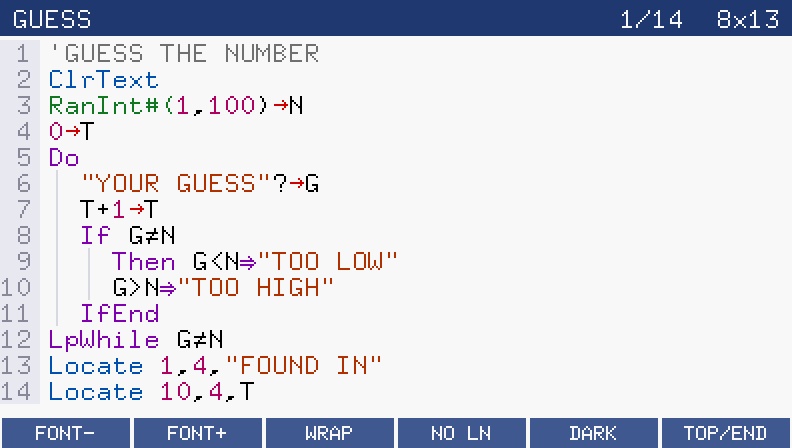
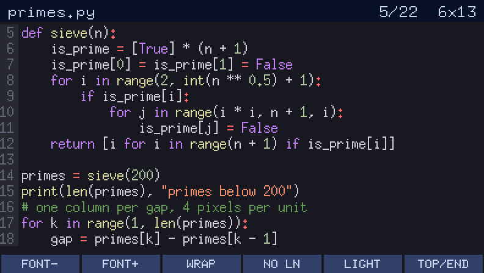

# CodeView

CodeView is an add-in for the Casio fx-CG50 that shows the Casio BASIC programs of the PRGM
app and the Python (`.py`) scripts on the calculator in a readable way: a fixed-width font in
six sizes, line numbers, automatic indentation of blocks, and syntax colours, in a light or a
dark theme. It only reads programs; it never changes them.



*A Casio BASIC program from the PRGM app: the `Do`/`If` blocks are indented, with guide lines
(light theme, 8x13 font).*



*A Python script in the dark theme with the smaller 6x13 font.*

## Features

- Lists the programs in main memory (the PRGM app's programs) and the `.py` files at the root
  of the storage memory.
- Shows Casio BASIC with the same command names as the PRGM editor. The text of each command
  comes from the calculator's own OS, and CASIO characters such as `→`, `⇒`, `≠` and `◢` are
  shown as such. The few characters a font lacks are shown as `□`.
- Indents the blocks of Casio BASIC (`If`, `For`, `While`, `Do`) by two columns per level, with
  faint guide lines. `Else`, `IfEnd`, `Next`, `WhileEnd` and `LpWhile` line up with their
  opening command.
- Colours keywords, commands, functions, strings, comments, numbers and operators. Python
  keywords, strings (including triple-quoted ones), comments, numbers and function calls are
  coloured too.
- Six fixed-width font sizes: 5x7, 6x10, 6x13, 8x13, 9x15 and 10x20.
- Line numbers on or off; long lines either wrap or scroll sideways.
- Light and dark themes.
- Remembers the theme, font size, wrapping and line numbers in `CodeView.cfg` in the storage
  memory.

## Install

1. Download `CodeView.g3a` from the Releases page.
2. Connect the calculator to a computer with a USB cable and choose USB Flash on the
   calculator.
3. Copy `CodeView.g3a` to the root of the calculator's drive, then eject the drive.
4. CodeView now has an icon in the MAIN MENU.

## Use

The first screen lists the programs (marked BASIC) and the Python scripts (marked PY).

| Key | In the list |
| --- | --- |
| UP, DOWN | Choose a program or script |
| EXE or F1 | Open it |
| F5 | Switch between the light and dark themes |
| F6 | Read the list again |
| MENU | Back to the MAIN MENU |

| Key | In the viewer |
| --- | --- |
| UP, DOWN | Scroll one line |
| SHIFT, then UP or DOWN | Scroll one page |
| LEFT, RIGHT | Scroll sideways (when lines don't wrap), or one page (when they wrap) |
| F1 or − | Smaller font |
| F2 or + | Larger font |
| F3 | Wrap long lines on or off |
| F4 | Line numbers on or off |
| F5 | Switch between the light and dark themes |
| F6 | Jump to the end, or back to the top |
| EXIT | Back to the list |

The title bar shows the first visible line, the number of lines and the font size.

## Building from source

CodeView is built with the [fxSDK](https://git.planet-casio.com/Lephenixnoir/fxsdk) and the
[gint](https://git.planet-casio.com/Lephenixnoir/gint) kernel (gint 2.9 or later). With the
fxSDK installed:

```
fxsdk build-cg
```

This makes `CodeView.g3a`.

`src/fonts.c` and `src/charmap.c` are generated files; they only need to be made again after
changing the fonts or the character map. `python3 tools/mkdata.py` makes them from the fonts in
`tools/fonts/` and the character database `tools/chars.toml` (it needs Python 3.11 or later).
`tools/mkicon.py` draws the menu icons (it needs Pillow).

## Credits

- The table from CASIO character codes to Unicode (`src/charmap.c`) is generated from the
  character database of [Cahute](https://gitlab.com/cahute/cahute) (`tools/chars.toml`),
  copyright 2024 Thomas Touhey, under the CeCILL 2.1 licence.
- The fonts are the X.org misc-fixed fonts (`tools/fonts/`, by Markus Kuhn and others), which
  are in the public domain.
- The OS system call numbers come from Simon Lothar's fx-CG documentation.
- CodeView runs on Lephenixnoir's gint and is built with the fxSDK.

## Licence

GPL-3.0-or-later (see `LICENSE`). `tools/chars.toml` and the table generated from it,
`src/charmap.c`, come from Cahute and stay under the CeCILL 2.1 licence, which is compatible with
the GPL. The fonts are public domain (`tools/fonts/COPYING-misc-misc`).
